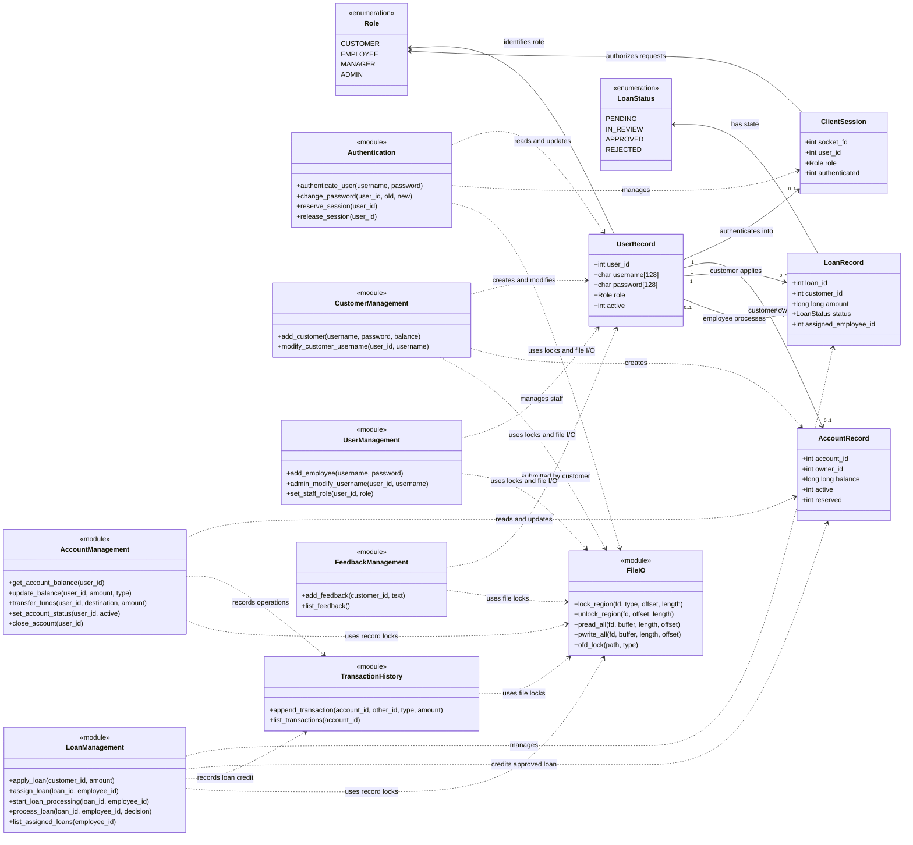

# Banking Management System — Class Diagram

The project is implemented in C, so the boxes below represent C structures,
enumerations, and modules rather than C++ or Java classes. Public module
functions are shown as operations.

## Role responsibilities

- **Customer:** balance, deposit, withdrawal, transfer, loan application,
  password change, feedback, and transaction history.
- **Employee:** customer creation and modification, account closing, customer
  history, and assigned-loan processing.
- **Manager:** account activation or deactivation, loan assignment, and
  feedback review.
- **Administrator:** employee creation, user modification, and staff-role
  management.

The server creates a `ClientSession` for every connected client. It checks the
session role before calling the appropriate module. Storage modules use
`FileIO` helpers and `fcntl` OFD locks to synchronize access to binary records.
